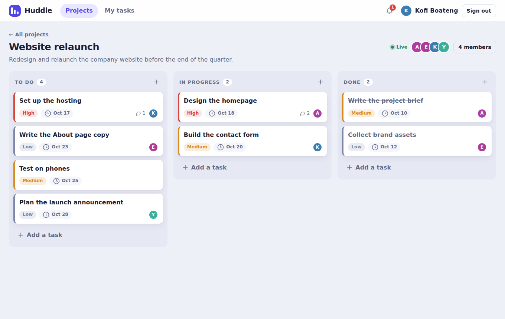
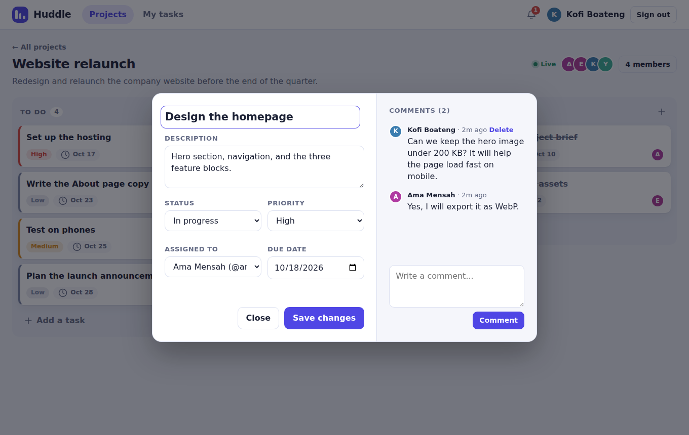
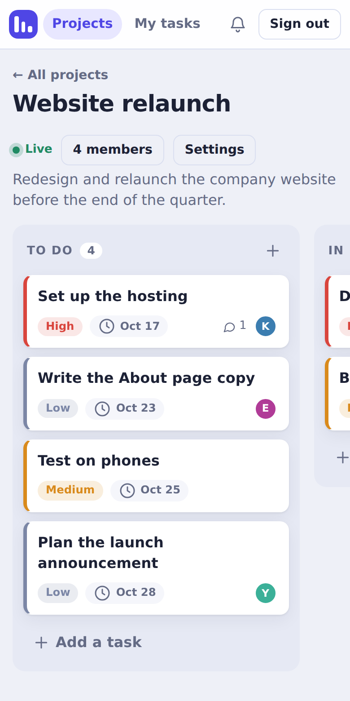

# CodeAlpha_ProjectManager

**Huddle** is a collaborative project management tool in the style of Trello and Asana, built as **Task 3** of the [CodeAlpha](https://www.codealpha.tech) Full Stack Development Internship. Teams create group projects, assign tasks on a Kanban board, and talk inside each task card. Changes, comments, and notifications show up for everyone **live over WebSockets**.







## Features

- **Accounts:** register and sign in with email or username. Passwords are hashed with bcrypt and sessions use JWTs.
- **Group projects:** create a project, then add people by username. Each project has an owner and members.
- **Project boards:** a Kanban board with **To do**, **In progress**, and **Done** columns. Drag cards between columns or reorder them within a column.
- **Task cards:** title, description, priority, due date (with overdue and due-today highlights), status, and an assignee.
- **Assign tasks:** assign any task to a project member. A "My tasks" page lists everything assigned to you across projects.
- **Comments inside tasks:** a conversation thread on every task. The author or the project owner can delete a comment.
- **Notifications (bonus):** you are notified when you are added to a project, assigned a task, or when someone comments on or finishes your task. A bell icon shows unread items.
- **Real-time updates (bonus):** WebSockets push new tasks, moves, edits, comments, member changes, and notifications to everyone watching the board, with automatic reconnect.
- **Roles:** only the owner can rename or delete a project and add or remove members. Members can leave on their own.
- **Responsive design** with light and dark themes. The board scrolls sideways on phones.

## Tech Stack

| Layer     | Technology                                   |
|-----------|----------------------------------------------|
| Frontend  | HTML, CSS, JavaScript (no framework)         |
| Backend   | Node.js, Express.js                          |
| Real time | WebSockets (`ws`)                            |
| Database  | MySQL 8                                      |
| Auth      | bcryptjs (password hashing), JSON Web Tokens |
| Testing   | Node's built-in test runner                  |

## Project Structure

```
CodeAlpha_ProjectManager/
├── client/
│   ├── index.html
│   ├── css/styles.css
│   └── js/app.js            # Single-page UI: projects, board, drag and drop, dialogs, WebSocket client
├── server/
│   ├── config/jwt.js
│   ├── db/                  # connection.js, schema.sql, migrate.js, seed.js
│   ├── lib/                 # access.js (permissions), tasks.js, order.js, notify.js, validate.js
│   ├── middleware/          # require-auth, require-database, rate-limit
│   ├── routes/              # auth, users, projects, tasks, notifications, health
│   └── realtime.js          # WebSocket hub: authentication, project rooms, broadcasts
├── tests/                   # unit tests + MySQL/WebSocket integration test
├── docs/screenshots/
├── app.js                   # Express app
├── server.js                # HTTP + WebSocket server
├── .env.example
└── package.json
```

## Database Schema

| Table             | Columns                                                                                                                                 |
|-------------------|-----------------------------------------------------------------------------------------------------------------------------------------|
| `users`           | `id`, `username` (unique), `name`, `email` (unique), `password_hash`, `created_at`                                                       |
| `projects`        | `id`, `name`, `description`, `owner_id`, `created_at`                                                                                    |
| `project_members` | `project_id`, `user_id`, `role` (`owner` or `member`), `joined_at` (primary key on `project_id, user_id`)                                |
| `tasks`           | `id`, `project_id`, `title`, `description`, `status`, `priority`, `due_date`, `assignee_id`, `created_by`, `position`, `created_at`, `updated_at` |
| `comments`        | `id`, `task_id`, `user_id`, `content`, `created_at`                                                                                      |
| `notifications`   | `id`, `user_id`, `actor_id`, `type`, `message`, `project_id`, `task_id`, `is_read`, `created_at`                                         |

Deleting a project removes its members, tasks, comments, and related notifications. Deleting a user who is assigned to or created a task keeps the task (`ON DELETE SET NULL`). `position` orders the cards inside each column.

`server/db/schema.sql` is the single source of truth. The server runs it on every startup (all statements use `CREATE TABLE IF NOT EXISTS`), so you only need to create the empty database.

## API Endpoints

Every endpoint except register, login, and health needs an `Authorization: Bearer <token>` header. Projects and tasks are only visible to project members; everyone else gets a `404`.

### Auth
| Method | Endpoint             | Description                                                 |
|--------|----------------------|-------------------------------------------------------------|
| POST   | `/api/auth/register` | Create an account (`name`, `username`, `email`, `password`) |
| POST   | `/api/auth/login`    | Sign in (`identifier` = email or username, `password`)      |
| GET    | `/api/auth/me`       | Current user                                                |

### Projects and members
| Method | Endpoint                          | Description                                         |
|--------|-----------------------------------|-----------------------------------------------------|
| GET    | `/api/projects`                   | Your projects with member and progress counts       |
| POST   | `/api/projects`                   | Create a project (`name`, optional `description`)   |
| GET    | `/api/projects/:id`               | The board: project, members, and all tasks          |
| PATCH  | `/api/projects/:id`               | Rename or edit the description (owner)              |
| DELETE | `/api/projects/:id`               | Delete the project (owner)                          |
| POST   | `/api/projects/:id/members`       | Add a member by `username` (owner)                  |
| DELETE | `/api/projects/:id/members/:userId` | Remove someone (owner), or leave the project (yourself) |
| GET    | `/api/users?q=`                   | Search people by username or name                   |

### Tasks and comments
| Method | Endpoint                              | Description                                             |
|--------|---------------------------------------|---------------------------------------------------------|
| POST   | `/api/projects/:id/tasks`             | Create a task (`title`, optional `status`, `priority`, `due_date`, `assignee_id`, `description`) |
| GET    | `/api/tasks/assigned`                 | Tasks assigned to you across projects                   |
| GET    | `/api/tasks/:id`                      | One task with its comments                              |
| PATCH  | `/api/tasks/:id`                      | Edit fields, change status, or reassign                 |
| POST   | `/api/tasks/:id/move`                 | Drag and drop: `status` and `index` in the column       |
| DELETE | `/api/tasks/:id`                      | Delete (the creator or the project owner)               |
| GET    | `/api/tasks/:id/comments`             | List comments                                           |
| POST   | `/api/tasks/:id/comments`             | Add a comment                                           |
| DELETE | `/api/tasks/:id/comments/:commentId`  | Delete a comment (its author or the project owner)      |

### Notifications and health
| Method | Endpoint                          | Description                          |
|--------|-----------------------------------|--------------------------------------|
| GET    | `/api/notifications`              | Latest 30 plus the unread count      |
| POST   | `/api/notifications/read-all`     | Mark all as read                     |
| POST   | `/api/notifications/:id/read`     | Mark one as read                     |
| GET    | `/api/health`                     | Server and database status           |

### WebSocket (`/ws`)
The client connects, sends `{"type":"auth","token":"<jwt>"}` as its first message (the token is not put in the URL), then `{"type":"subscribe","projectId":1}`. The server checks membership before it lets a socket join a project. Events pushed to subscribers: `tasks.changed`, `task.deleted`, `comment.created`, `comment.deleted`, `members.changed`, `project.updated`, `project.deleted`, and `member.removed`. Each user also receives their own `notification` and `projects.changed` events.

## Getting Started

### Prerequisites

- [Node.js](https://nodejs.org/) v18 or later
- [MySQL](https://dev.mysql.com/downloads/mysql/) v8.0 or later (MariaDB is not supported)

### Installation

1. **Clone the repository**
   ```bash
   git clone https://github.com/<your-username>/CodeAlpha_ProjectManager.git
   cd CodeAlpha_ProjectManager
   ```

2. **Install dependencies**
   ```bash
   npm install
   ```

3. **Create the database and an application user**

   In MySQL Workbench (or the `mysql` prompt), run:
   ```sql
   CREATE DATABASE huddle_projects CHARACTER SET utf8mb4 COLLATE utf8mb4_0900_ai_ci;
   CREATE USER 'huddle_app'@'localhost' IDENTIFIED BY 'replace_with_a_strong_password';
   GRANT SELECT, INSERT, UPDATE, DELETE, CREATE, ALTER, INDEX, REFERENCES ON huddle_projects.* TO 'huddle_app'@'localhost';
   ```
   The server creates the tables itself when it starts, which is why the user needs `CREATE`, `ALTER`, `INDEX`, and `REFERENCES`. For quick local use you can also put your `root` login in `.env`.

4. **Configure environment variables**

   Copy `.env.example` to `.env` and fill it in:
   ```env
   PORT=5000
   DB_HOST=localhost
   DB_PORT=3306
   DB_USER=huddle_app
   DB_PASSWORD=replace_with_a_strong_password
   DB_NAME=huddle_projects
   JWT_SECRET=replace_with_a_random_string_of_at_least_32_characters
   MYSQL_SSL=false
   ```
   Generate a secret with:
   ```bash
   node -e "console.log(require('crypto').randomBytes(48).toString('hex'))"
   ```

5. **(Optional) Add demo data**
   ```bash
   npm run seed
   ```
   This creates four demo people and a "Website relaunch" project with tasks, comments, and a notification. Sign in as `ama_designs` (the owner), `kofi_codes`, `esi_reads`, or `yaw_runs` with the password `Password123!`. These accounts are for local demos only.

6. **Start the server**
   ```bash
   npm start
   ```
   Open `http://localhost:5000`.

### See it live

Open the app in two different browsers (or one normal and one private window) and sign in as two demo users. Add, drag, and comment on tasks in one window and watch the other update instantly.

## Tests

```bash
npm test                    # unit tests: validation, ordering, and middleware (no database needed)
npm run test:integration    # full API and WebSocket test against your MySQL database (uses .env)
```

The integration test registers its own temporary users (with a random suffix), exercises every endpoint, checks permissions, and verifies live events over real WebSocket connections, then deletes those users.

## Security Notes

- Passwords are hashed with bcrypt and never returned by the API.
- Every protected route verifies a JWT. Project and task access is checked against project membership on each request, and non-members receive `404` so other people's projects are not revealed.
- Role rules are enforced on the server: only owners manage projects and members, and only creators or owners delete tasks.
- WebSockets must authenticate with a valid token, only join projects the user belongs to, are removed from a project's live feed the moment they lose access, and reject cross-site origins.
- All database queries use parameterized statements. User text is escaped before it is displayed, so pasted HTML appears as plain text.
- Sign-in and registration are rate limited per IP address.
- Secrets live in `.env`, which is excluded from version control.

## Future Improvements

- Custom columns and more than three statuses
- File attachments and @mentions in comments
- Email notifications and an activity log
- Search and filters on the board

## Author

**Storm**
[GitHub](https://github.com/244star)

## Acknowledgements

Built as part of the Full Stack Development internship at [CodeAlpha](https://www.codealpha.tech).
